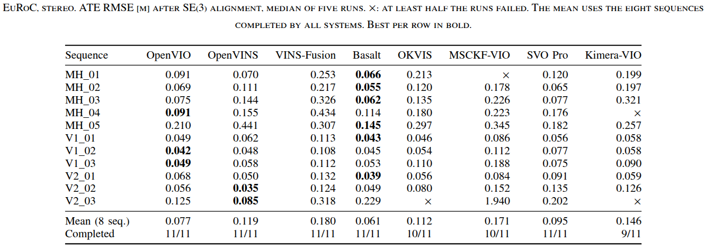
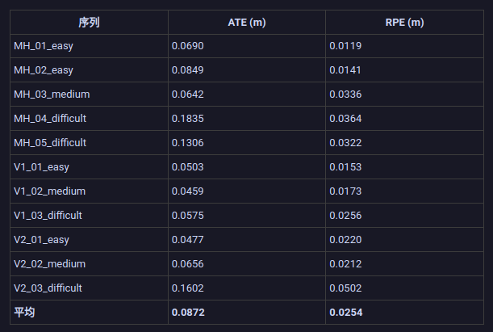
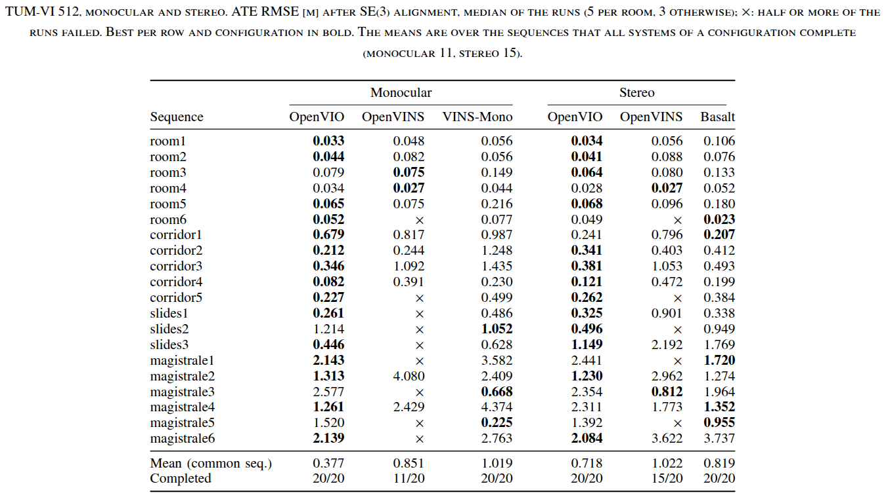
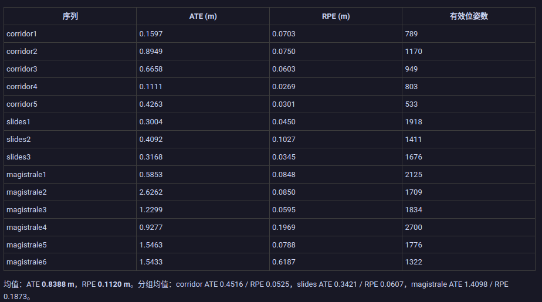
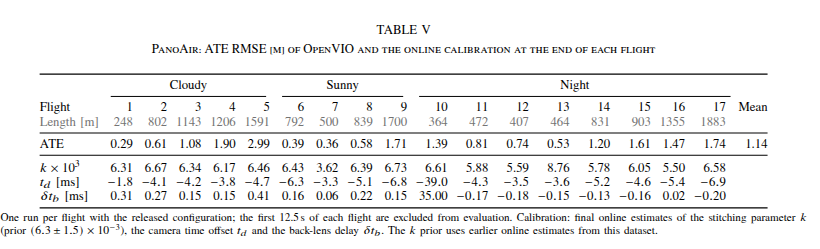
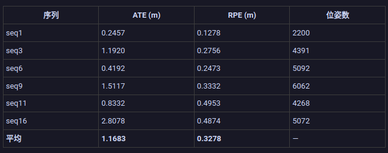

**白色图片为开源代码的测试结果，黑色图片是自己的测试结果**

## 双目 VIO 
### EuRoc

- 报告的是 11 条序列均值 0.0872；开源表中均值只取 8 条所有系统都成功的序列。取相同 8 条（去掉 MH_01、MH_04、V2_03）后的均值为 0.0683。
- 排名：Basalt 0.061 < self 0.068 < OpenVIO 0.077 < SVO Pro 0.095 < OKVIS 0.112 < OpenVINS 0.119 < Kimera 0.146 < MSCKF 0.171 < VINS-Fusion 0.180。

### TUM-VI

- 只测了 14 条非 room 序列（corridor/slides/magistrale）。在完全相同的 14 条上：OpenVIO 1.081、Basalt 1.125、OpenVINS 1.58（9 条），self 0.839 最小。

- 分组：slides 0.342 < corridor 0.452 << magistrale 1.410。magistrale 贡献了72% 的误差。

- 在 8/14 条上最优（尤其 slides3 0.317 vs OpenVIO 1.149、magistrale1 0.585 vs Basalt 1.720、magistrale4 0.928 vs Basalt 1.352）；明显落后的是 magistrale2 (2.626 vs 1.230)、magistrale5 (1.546 vs 0.955)、corridor2/3。

## 全景相机 VIO

- 去掉 seq16 后你的均值 0.842 与 OpenVIO 0.842 完全持平。
- [TODO] seq16  2.808 vs OpenVIO 1.47 是唯一异常，需排查 PanoAir seq16 的异常漂移，Night 长航程飞行。

## SLAM Challenge Dataset 
[TODO]
### 2022
[TODO]
### 2023
[TODO]

